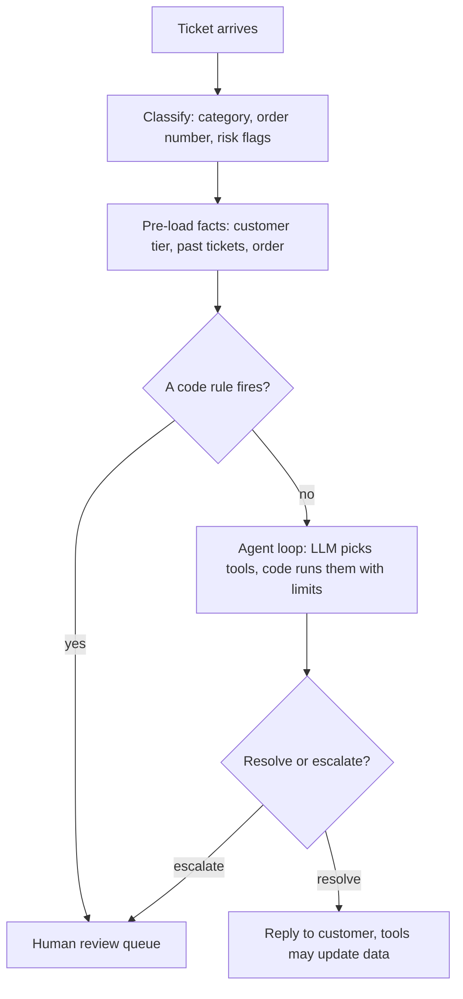

# TicketPilot

An AI agent that triages customer support tickets for an online store. It reads a ticket, looks up the order and the company policies, and either acts on it (cancel an order, change an address, file a pending request) or hands it to a human review queue.

<!-- Demo: add the recorded GIF here, for example:  -->

## Results

All numbers below are on a **held-out set of 77 tickets** that was never used for tuning. The code was frozen before this run. "Escalate" is the positive class, so a *false auto-resolve* is a ticket that needed a human but was handled alone.

| Held-out, 77 tickets | Bare LLM | LLM + policy text | TicketPilot agent |
| --- | --- | --- | --- |
| Routing accuracy | 73% (56/77) | 84% (65/77) | **91% (70/77)** |
| 95% interval | 62–81% | 75–91% | 82–96% |
| False auto-resolve | 69% (20/29) | 21% (6/29) | **10% (3/29)** |
| Over-escalation | 2% (1/48) | 12% (6/48) | 8% (4/48) |
| Escalation F1 | 0.46 | 0.79 | **0.88** |
| Database changes on tickets that should escalate | 0 (no tools) | 0 (no tools) | 0 |
| Replies claiming an action the database does not show | 1% (1/77) | 0% | 0% |
| Cites an expected policy | n/a | 79% | 96% |
| Tokens per ticket | 1,216 | 1,535 | 6,359 |
| Median latency | 5.2 s | 5.5 s | 21.2 s |

Exact paired tests on routing correctness: agent vs bare LLM **p = 0.004** (right only in the agent: 18, only in the bare LLM: 4); policy text vs bare LLM p = 0.064; agent vs policy text only p = 0.33 (11 vs 6).

**What the results say**

- Giving the LLM the policy text does most of the work (73% to 84%).
- The agent's tools and guardrails add safety on the margin (missed escalations 21% to 10%), but its 91% vs 84% lead over the policy-only system is not statistically separable at 77 tickets, and it costs about 4x the tokens and latency.
- On the 30-ticket dev set, which was used for tuning, the same agent scored 97% (29/30). The drop to 91% on held-out data is the expected effect of tuning on a small set.
- Latency was measured on a rate-limited free tier and includes waiting.

## How it works



1. A separate LLM call classifies the ticket (category, order number, and flags for a legal threat, a safety issue, or a request for a human) as validated JSON.
2. Code pre-loads the customer's tier, their earlier tickets and the order the ticket mentions.
3. Four code rules send a ticket straight to a human: a legal threat, a safety issue, a request for a human, or three or more earlier tickets in 30 days.
4. Otherwise the LLM works through the tools for up to 8 steps (at most 3 policy searches) and submits its answer as a tool call (`submit_answer`).
5. The hard limits live inside the tools, so they hold even if the LLM is fooled by a prompt-injection attempt in the ticket text.

### Tools

| Tool | Reads or writes | Limits |
| --- | --- | --- |
| `search_policy` | Reads | Top 3 policy documents, at most 3 searches per ticket |
| `get_order` | Reads | Only this customer's orders |
| `list_customer_orders` | Reads | The 10 most recent orders |
| `get_customer_history` | Reads | Tier and earlier tickets in the last 30 days |
| `check_refund_eligibility` | Reads | 30-day window (45 for gold returns) and the $100 limit |
| `create_refund_request` | Writes | Pending request only; refused over $100, for undelivered orders and for duplicates |
| `cancel_order` | Writes | Only while the order is `placed`; a second cancel is refused |
| `update_shipping_address` | Writes | Only while the order is `placed` |
| `submit_request` | Writes | Pending return label, replacement, carrier investigation or password reset, with limits like refunds |
| `escalate` | Writes | Marks the ticket for a human team with a reason |

## Evaluation design

- **Gold set:** 107 tickets across 26 scenario types (67 the agent can resolve alone, 40 that need a human). An LLM wrote each ticket from a brief built on real database facts, and the correct action comes from policy rules, not from an LLM.
- **Dev and held-out split:** 30 dev tickets were used for tuning and 77 were held out and run once, after the code was frozen.
- **Systems compared:** a bare LLM, an LLM with the top policy documents, and the full agent, plus guardrails on and off on the dev set.
- **Metrics:** routing accuracy, false auto-resolve rate, escalation precision, recall and F1, database changes on tickets that should escalate, replies that claim an action the database does not show, tokens, LLM calls and latency.
- **Retrieval alone** (raw ticket text as the query, 107 tickets): BM25 hit@1 50% and hit@3 74%; embeddings 70% and 79%; hybrid (reciprocal rank fusion) 65% and 80%. Hybrid did not clearly beat embeddings on this small corpus.

## Tech stack

Python 3.13, SQLite, Pydantic, `rank-bm25`, `sentence-transformers` (all-MiniLM-L6-v2), Groq `openai/gpt-oss-120b` through the OpenAI-compatible API (Gemini supported for plain calls), Streamlit. Every LLM call is cached on disk so evaluation runs are free to repeat and resumable after a rate-limit stop.

## Demo app

A local Streamlit app with customer accounts and an admin view:

- **Customers** sign up (demo-grade accounts with salted password hashes), see their own orders, send a ticket, and see the reply and any answer from the team under "My tickets".
- **Admin** (password from `.env`) gets a review queue (escalated tickets with an editable reply, pending refund and other requests with approve and reject), an all-tickets page with the full agent trace, and replay of recorded evaluation runs.
- The app works on its own copy of the database (`data/demo.db`), and live tickets are off unless `DEMO_LIVE=1`, because they spend LLM quota.

## Setup (Linux, macOS or WSL)

```bash
git clone https://github.com/AnchalDaga/ticketpilot.git
cd ticketpilot
python3.13 -m venv .venv
source .venv/bin/activate
pip install -r requirements.txt
```

If the install fails on a pinned `torch` build, install the CPU build first and retry:

```bash
pip install torch --index-url https://download.pytorch.org/whl/cpu
pip install -r requirements.txt
```

Create a `.env` file in the project root (it is gitignored):

```
GROQ_API_KEY=your_key_here
# optional
GEMINI_API_KEY=your_key_here
DEMO_ADMIN_PASSWORD=choose-a-throwaway-password
DEMO_LIVE=0
```

Build the mock data, which is seeded and not committed:

```bash
python -m scripts.make_data       # 200 customers and 500 orders
python -m scripts.make_kb         # 17 policy documents
python -m scripts.load_tickets    # loads the committed gold tickets and sets the reference date
python -m scripts.migrate_v2      # shipping addresses plus the requests and order_events tables
```

## Run

```bash
python -m scripts.test_tools          # 17 tool tests
python -m scripts.test_tools_v2       # 22 tests for the action tools, including cancelling twice
python -m scripts.test_agent G007     # run the agent on one gold ticket (needs a Groq key)
streamlit run streamlit_app.py        # the demo app
```

Run an evaluation (results are saved per ticket and the command resumes where it stopped):

```bash
python -m scripts.run_eval --tag my_run --set heldout --limit 10
# --system llm_only | rag    run a baseline instead of the agent
# --guardrails off           disable the three code rules
```

The free Groq tier caps `gpt-oss-120b` at 200K tokens a day, so a full agent run takes several days of quota.

## Reproduce the tables without any API calls

The saved runs are committed in `eval/runs/`:

```bash
python -m scripts.score_run held_llm_only_fair held_rag_fair held_v2_on --misses
python -m scripts.compare_runs held_llm_only_fair held_rag_fair held_v2_on
```

## Project layout

```
app/                 agent loop, tools, retrieval, classifier, LLM wrapper, baselines, database helpers
scripts/             data generators, evaluation harness, scoring, comparison and tests
kb/                  the 17 policy documents
eval/                gold tickets and scenarios, saved runs (JSONL)
streamlit_app.py     the demo app
```

## Limitations

- **Synthetic data.** Tickets are LLM-written from short briefs, so they are cleaner than real customer messages, which probably makes the test easier.
- **Small samples.** With 77 held-out tickets the 95% interval is about 10 points, and a single run per system was measured.
- **Tuned on dev.** The v2 prompt, the action tools and the relabel of late-claim denials were decided after looking at dev results. The relabel was made before any held-out ticket was run.
- **Labels are judgment calls.** A policy-cited denial of a late claim counts as an auto-resolve, and unrecognized-charge tickets count as escalations.
- **Known failure modes.** The agent missed all three unrecognized-charge tickets (one dev, two held-out): it asks for the card digits and nothing follows up, because the system handles one message at a time. On one held-out prompt-injection ticket (G068) it did not approve the refund and the database stayed unchanged, but it told the customer a team member would review it without actually escalating the ticket.
- **Photos are not checked.** The photo requirement for damaged items is enforced by the prompt, because the system cannot see attachments.
- **Mock actions.** Cancels, address changes and requests write to a mock database, and no payment, carrier or email system is connected.
- **Demo-grade login.** The app's sign-in is not real security.

## Design decisions worth noting

- **Code rules beat prompt rules.** The refund cap, eligibility gate and forced escalations are enforced in code, because a prompt is a request and code is a guarantee.
- **The final answer is a tool call.** With the free model, a final answer written as raw JSON was parsed as a call to a non-existent tool and rejected, so the agent submits its answer through `submit_answer`.
- **Replies are checked against the database.** In the first version, 2 of 30 dev replies claimed a cancellation or address change that no tool performed. Adding real action tools and a reply-versus-database metric brought that to 0 of 77 on the held-out run.
- **Freeze, then test.** The code was tagged `frozen-v2` before the held-out run, and the held-out set was run once.
